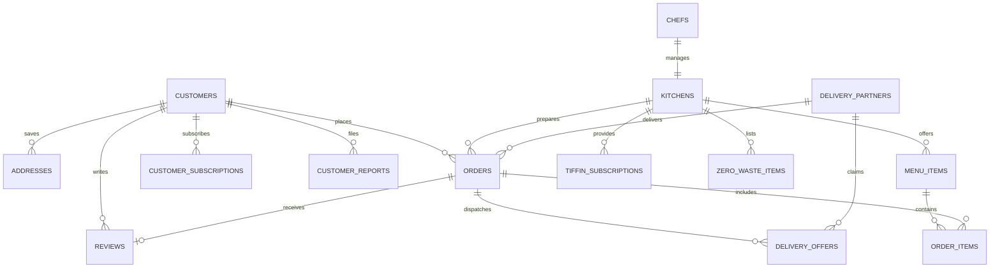

# Kravyo Data Dictionary & Database Architecture

This document provides a comprehensive technical reference for the **20 tables** in the Kravyo database (`kravyo_db`), detailing their business purpose, schema attributes, constraints, default values, and the UI triggers that populate and update them.

---

## Database Overview
* **Database Name:** `kravyo_db`
* **Engine:** InnoDB (MySQL 8+ / MariaDB)
* **Default Charset:** `utf8mb4`
* **Default Collation:** `utf8mb4_unicode_ci`
* **Total Tables:** 20

---

## Entity Relationship Overview

---

## Detailed Table Definitions

### 1. `addresses`
* **Purpose:** Saved delivery addresses for customers with GPS coordinates and soft-delete protection.
* **UI Ingestion:** Profile address manager (`POST /profile/address/add`), Checkout new address creation (`POST /checkout`).

| Attribute | Type | Nullable | Default | Constraints / Extra | Description |
|---|---|---|---|---|---|
| `id` | `int(11)` | NO | *None* | `PRIMARY KEY`, `AUTO_INCREMENT` | Unique address ID |
| `user_id` | `int(11)` | NO | *None* | `INDEX` (FK &rarr; `customers.id`) | Customer owner ID |
| `address_type` | `enum('Home','Work','Other')` | YES | `'Home'` | | Label category |
| `apartment` | `varchar(150)` | YES | `NULL` | | Flat / Suite / Floor |
| `street_address` | `text` | NO | *None* | | Full street address |
| `landmark` | `varchar(150)` | YES | `NULL` | | Nearby landmark |
| `city` | `varchar(100)` | NO | *None* | | City name |
| `pincode` | `char(6)` | NO | *None* | | 6-digit postal code |
| `latitude` | `decimal(10,8)` | YES | `NULL` | | Exact GPS latitude |
| `longitude` | `decimal(11,8)` | YES | `NULL` | | Exact GPS longitude |
| `is_deleted` | `tinyint(1)` | NO | `0` | | Soft-delete flag (preserves order history) |
| `created_at` | `timestamp` | NO | `CURRENT_TIMESTAMP` | | Record timestamp |

---

### 2. `admins`
* **Purpose:** Administrative user accounts with platform-wide management permissions.
* **UI Ingestion:** Initial system setup or Admin user management portal.

| Attribute | Type | Nullable | Default | Constraints / Extra | Description |
|---|---|---|---|---|---|
| `id` | `int(11)` | NO | *None* | `PRIMARY KEY`, `AUTO_INCREMENT` | Admin account ID |
| `full_name` | `varchar(50)` | NO | *None* | | Full administrative name |
| `email` | `varchar(50)` | NO | *None* | `UNIQUE KEY` | Admin login email |
| `phone` | `char(10)` | NO | *None* | `INDEX` | 10-digit mobile number |
| `password_hash` | `varchar(60)` | NO | *None* | | Bcrypt password hash |
| `status` | `enum('active','inactive','suspended','pending_verification')` | NO | `'active'` | | Account status |
| `email_verified`| `tinyint(1)` | NO | `0` | | Email verification flag |
| `email_otp_hash`| `varchar(255)`| YES | `NULL` | | Email OTP hash |
| `email_otp_expires_at` | `datetime` | YES | `NULL` | | OTP expiry timestamp |
| `email_otp_resent_at`  | `datetime` | YES | `NULL` | | Resend cooldown timer |
| `email_otp_attempts`   | `tinyint(1)`| NO | `0` | | Failed OTP attempts |
| `reset_otp_hash`       | `varchar(60)`| YES| `NULL` | | Password reset OTP hash |
| `reset_otp_expires_at` | `datetime` | YES | `NULL` | | Reset expiry timestamp |
| `reset_otp_resent_at`  | `datetime` | YES | `NULL` | | Reset resend cooldown |
| `reset_otp_attempts`   | `tinyint(3)`| NO | `0` | | Failed reset attempts |
| `created_at` | `timestamp` | NO | `CURRENT_TIMESTAMP` | | Account creation time |
| `updated_at` | `timestamp` | NO | `CURRENT_TIMESTAMP` | `ON UPDATE CURRENT_TIMESTAMP` | Last updated time |
| `last_login_at` | `timestamp` | YES | `NULL` | | Last authentication time |

---

### 3. `categories`
* **Purpose:** Cuisine and dish classification categories (e.g., Gujarati, North Indian, Desserts).
* **UI Ingestion:** Admin Category Management (`POST /admin/categories/add`).

| Attribute | Type | Nullable | Default | Constraints / Extra | Description |
|---|---|---|---|---|---|
| `id` | `int(11)` | NO | *None* | `PRIMARY KEY`, `AUTO_INCREMENT` | Category ID |
| `category_name` | `varchar(50)` | NO | *None* | `INDEX` | Category display name |
| `description` | `text` | YES | `NULL` | | Category description |
| `image` | `varchar(255)` | YES | `NULL` | | Image filename in `uploads/categories` |
| `created_at` | `timestamp` | NO | `CURRENT_TIMESTAMP` | | Creation timestamp |

---

### 4. `chefs`
* **Purpose:** Home chef user accounts authenticated into the Chef Portal.
* **UI Ingestion:** Registration portal (`POST /register` with role `chef`), OTP verification.

| Attribute | Type | Nullable | Default | Constraints / Extra | Description |
|---|---|---|---|---|---|
| `id` | `int(11)` | NO | *None* | `PRIMARY KEY`, `AUTO_INCREMENT` | Chef user ID |
| `full_name` | `varchar(50)` | NO | *None* | | Chef name |
| `email` | `varchar(50)` | NO | *None* | `UNIQUE KEY` | Login email address |
| `phone` | `char(10)` | NO | *None* | `INDEX` | 10-digit mobile number |
| `city` | `varchar(100)` | YES | `NULL` | | Primary operating city |
| `password_hash` | `varchar(60)` | NO | *None* | | Bcrypt password hash |
| `role` | `enum('chef')` | NO | `'chef'` | | Role identifier |
| `status` | `enum('active','inactive','suspended','pending_verification')` | NO | `'active'` | | Account status |
| `email_verified`| `tinyint(1)` | NO | `0` | | OTP verification flag |
| `email_otp_hash`| `varchar(255)`| YES | `NULL` | | Email verification OTP hash |
| `email_otp_expires_at` | `datetime` | YES | `NULL` | | OTP expiry |
| `email_otp_resent_at`  | `datetime` | YES | `NULL` | | Cooldown timestamp |
| `email_otp_attempts`   | `tinyint(1)`| NO | `0` | | Attempt counter |
| `reset_otp_hash`       | `varchar(60)`| YES| `NULL` | | Password reset hash |
| `reset_otp_expires_at` | `datetime` | YES | `NULL` | | Reset expiry |
| `reset_otp_resent_at`  | `datetime` | YES | `NULL` | | Reset cooldown |
| `reset_otp_attempts`   | `tinyint(3)`| NO | `0` | | Reset attempts |
| `created_at` | `timestamp` | NO | `CURRENT_TIMESTAMP` | | Account creation time |
| `updated_at` | `timestamp` | NO | `CURRENT_TIMESTAMP` | `ON UPDATE CURRENT_TIMESTAMP` | Last updated time |

---

### 5. `customers`
* **Purpose:** Customer user accounts authenticated into the Customer Portal.
* **UI Ingestion:** Registration portal (`POST /register`), OTP verification.

*(Attributes mirror the `chefs` table, with role defaulting to `'customer'`)*

---

### 6. `customer_reports`
* **Purpose:** Audit logs for customer-filed issue reports and complaints (quality, delivery delay, missing items).
* **UI Ingestion:** Order tracking / profile report modal (`POST /customer/report/submit`).

| Attribute | Type | Nullable | Default | Constraints / Extra | Description |
|---|---|---|---|---|---|
| `id` | `int(11)` | NO | *None* | `PRIMARY KEY`, `AUTO_INCREMENT` | Report ID |
| `customer_id` | `int(11)` | NO | *None* | `INDEX` (FK &rarr; `customers.id`) | Submitting customer ID |
| `kitchen_id` | `int(11)` | YES | `NULL` | `INDEX` (FK &rarr; `kitchens.id`) | Reported kitchen (if applicable) |
| `order_id` | `int(11)` | YES | `NULL` | `INDEX` (FK &rarr; `orders.id`) | Associated order ID |
| `report_type` | `enum('kitchen','dish','delivery','general')` | NO | `'general'` | | Category of issue |
| `subject` | `varchar(150)` | NO | *None* | | Issue headline |
| `description` | `text` | NO | *None* | | Full customer statement |
| `status` | `enum('pending','investigating','resolved','dismissed')` | NO | `'pending'` | | Admin resolution status |
| `admin_notes` | `text` | YES | `NULL` | | Internal resolution comments |
| `resolved_at` | `datetime` | YES | `NULL` | | Resolution timestamp |
| `created_at` | `timestamp` | NO | `CURRENT_TIMESTAMP` | | Submission timestamp |

---

### 7. `customer_subscriptions`
* **Purpose:** Customer active tiffin meal subscription agreements.
* **UI Ingestion:** Tiffin checkout (`POST /subscription/subscribe`).

| Attribute | Type | Nullable | Default | Constraints / Extra | Description |
|---|---|---|---|---|---|
| `id` | `int(11)` | NO | *None* | `PRIMARY KEY`, `AUTO_INCREMENT` | Subscription ID |
| `customer_id` | `int(11)` | NO | *None* | `INDEX` (FK &rarr; `customers.id`) | Subscribed customer |
| `plan_id` | `int(11)` | NO | *None* | `INDEX` (FK &rarr; `tiffin_subscriptions.id`) | Tiffin plan ID |
| `kitchen_id` | `int(11)` | NO | *None* | `INDEX` (FK &rarr; `kitchens.id`) | Fulfilling kitchen |
| `address_id` | `int(11)` | NO | *None* | `INDEX` (FK &rarr; `addresses.id`) | Delivery address |
| `start_date` | `date` | NO | *None* | | First delivery date |
| `end_date` | `date` | NO | *None* | | Final delivery date |
| `status` | `enum('active','paused','completed','cancelled')` | NO | `'active'` | | Plan status |
| `created_at` | `timestamp` | NO | `CURRENT_TIMESTAMP` | | Created timestamp |
| `updated_at` | `timestamp` | NO | `CURRENT_TIMESTAMP` | `ON UPDATE CURRENT_TIMESTAMP` | Updated timestamp |

---

### 8. `delivery_offers`
* **Purpose:** Active and historical dispatch broadcast / cascade delivery offers to riders.
* **UI Ingestion:** `DispatchService::pingBestMatch()` & `DispatchService::broadcastFallback()`.

| Attribute | Type | Nullable | Default | Constraints / Extra | Description |
|---|---|---|---|---|---|
| `id` | `int(11)` | NO | *None* | `PRIMARY KEY`, `AUTO_INCREMENT` | Offer ID |
| `order_id` | `int(11)` | NO | *None* | `INDEX` (FK &rarr; `orders.id`) | Dispatched order ID |
| `delivery_partner_id`| `int(11)`| NO | *None* | `INDEX` (FK &rarr; `delivery_partners.id`)| Targeted rider ID |
| `status` | `enum('offered','accepted','rejected','expired')` | NO | `'offered'` | | Offer state |
| `offered_at` | `datetime` | NO | *None* | | Dispatch timestamp |
| `expires_at` | `datetime` | NO | *None* | | Expiry countdown timestamp |
| `responded_at`| `datetime` | YES | `NULL` | | Response timestamp |
| `created_at` | `timestamp` | NO | `CURRENT_TIMESTAMP` | | Creation timestamp |

---

### 9. `delivery_partners`
* **Purpose:** Operational profile, vehicle credentials, location coordinates, and duty status for delivery riders.
* **UI Ingestion:** Delivery registration (`POST /delivery/register`), Location update API (`POST /delivery/location/update`).

| Attribute | Type | Nullable | Default | Constraints / Extra | Description |
|---|---|---|---|---|---|
| `id` | `int(11)` | NO | *None* | `PRIMARY KEY`, `AUTO_INCREMENT` | Rider profile ID |
| `user_id` | `int(11)` | NO | *None* | `INDEX` (FK &rarr; `delivery_users.id`) | User login account |
| `vehicle_type` | `enum('bicycle','motorcycle','scooter','ev')` | NO | `'motorcycle'` | | Vehicle transport mode |
| `vehicle_number` | `varchar(20)`| YES | `NULL` | | License plate number |
| `driving_license_number`| `varchar(50)`| YES | `NULL` | | Driving license ID |
| `is_online` | `tinyint(1)` | NO | `0` | | Shift duty toggle (*Online/Offline*) |
| `is_available` | `tinyint(1)` | NO | `1` | | Current delivery availability |
| `current_lat` | `decimal(10,8)`| YES | `NULL` | | Live GPS latitude |
| `current_lng` | `decimal(11,8)`| YES | `NULL` | | Live GPS longitude |
| `location_updated_at` | `datetime` | YES | `NULL` | | Timestamp of last GPS ping |
| `rating` | `decimal(3,2)`| NO | `5.00` | | Rider average rating |
| `total_deliveries` | `int(11)` | NO | `0` | | Completed delivery count |
| `approval_status` | `enum('pending','approved','rejected')` | NO | `'pending'` | | Admin verification status |
| `created_at` | `timestamp` | NO | `CURRENT_TIMESTAMP` | | Registration timestamp |
| `updated_at` | `timestamp` | NO | `CURRENT_TIMESTAMP` | `ON UPDATE CURRENT_TIMESTAMP` | Last updated timestamp |

---

### 10. `delivery_users`
* **Purpose:** Authentication credentials for delivery riders (`KRAVYO_DELIVERY` context).
* **UI Ingestion:** `POST /delivery/register`.

*(Attributes mirror the `chefs` and `customers` table with role `'delivery'`)*

---

### 11. `kitchens`
* **Purpose:** Cloud kitchen profile, physical coordinates, FSSAI compliance, and operational status.
* **UI Ingestion:** Chef Onboarding (`POST /chef/profile`), Coordinates picker (`POST /chef/profile/location`).

| Attribute | Type | Nullable | Default | Constraints / Extra | Description |
|---|---|---|---|---|---|
| `id` | `int(11)` | NO | *None* | `PRIMARY KEY`, `AUTO_INCREMENT` | Kitchen ID |
| `user_id` | `int(11)` | NO | *None* | `INDEX` (FK &rarr; `chefs.id`) | Chef owner ID |
| `kitchen_name` | `varchar(50)` | NO | *None* | | Kitchen display name |
| `personal_story` | `text` | YES | `NULL` | | Chef culinary bio & story |
| `address` | `text` | NO | *None* | | Physical address |
| `city` | `varchar(100)` | NO | *None* | | Operating city |
| `pincode` | `char(6)` | NO | *None* | | Postal pincode |
| `latitude` | `decimal(10,8)` | YES | `NULL` | `INDEX` (Part of `idx_kitchens_geo`) | Exact GPS latitude |
| `longitude` | `decimal(11,8)` | YES | `NULL` | `INDEX` (Part of `idx_kitchens_geo`) | Exact GPS longitude |
| `fssai_license` | `varchar(20)` | YES | `NULL` | | 14-digit FSSAI license |
| `hygiene_badge` | `enum('none','verified')` | YES | `'none'` | | Admin hygiene rating |
| `hygiene_certificate_image` | `varchar(255)` | YES | `NULL` | | FSSAI certificate document |
| `approval_status` | `enum('pending','approved','rejected','suspended')` | YES | `'pending'` | `INDEX` | Admin verification status |
| `admin_notes` | `text` | YES | `NULL` | | Internal admin review notes |
| `is_open` | `tinyint(1)` | YES | `1` | | Kitchen open/closed status |
| `banner_image` | `varchar(255)` | YES | `NULL` | | Cover photo in `uploads/kitchens` |
| `created_at` | `timestamp` | NO | `CURRENT_TIMESTAMP` | | Creation timestamp |
| `updated_at` | `timestamp` | NO | `CURRENT_TIMESTAMP` | `ON UPDATE CURRENT_TIMESTAMP` | Last updated timestamp |

---

### 12. `menu_items`
* **Purpose:** Dish catalog items belonging to a kitchen.
* **UI Ingestion:** Chef Dish Creator (`POST /chef/menu/add`).

| Attribute | Type | Nullable | Default | Constraints / Extra | Description |
|---|---|---|---|---|---|
| `id` | `int(11)` | NO | *None* | `PRIMARY KEY`, `AUTO_INCREMENT` | Dish ID |
| `kitchen_id` | `int(11)` | NO | *None* | `INDEX` (FK &rarr; `kitchens.id`) | Kitchen ID |
| `category_id` | `int(11)` | NO | *None* | `INDEX` (FK &rarr; `categories.id`)| Food category ID |
| `item_name` | `varchar(50)` | NO | *None* | | Dish title |
| `description` | `text` | YES | `NULL` | | Ingredients & details |
| `price` | `decimal(6,2)` | NO | *None* | | Price in INR (₹) |
| `image` | `varchar(255)` | YES | `NULL` | | Image in `uploads/dishes` |
| `is_veg` | `tinyint(1)` | YES | `1` | | Vegetarian indicator |
| `is_jain_available` | `tinyint(1)`| YES | `0` | | Jain dietary option |
| `is_diabetic_friendly`| `tinyint(1)`| YES| `0` | | Diabetic friendly |
| `is_available` | `tinyint(1)` | YES | `1` | | Stock availability |
| `created_at` | `timestamp` | NO | `CURRENT_TIMESTAMP` | | Creation timestamp |
| `updated_at` | `timestamp` | NO | `CURRENT_TIMESTAMP` | `ON UPDATE CURRENT_TIMESTAMP` | Last updated timestamp |

---

### 13. `notifications`
* **Purpose:** In-app real-time notification records across all 4 user roles.
* **UI Ingestion:** Triggered by system events (order placed, refund issued, driver pinged).

| Attribute | Type | Nullable | Default | Constraints / Extra | Description |
|---|---|---|---|---|---|
| `id` | `int(11)` | NO | *None* | `PRIMARY KEY`, `AUTO_INCREMENT` | Notification ID |
| `user_id` | `int(11)` | YES | `NULL` | `INDEX` | Recipient user ID |
| `user_type` | `enum('customer','chef','delivery','admin')` | NO | *None* | | Recipient portal role |
| `title` | `varchar(100)` | NO | *None* | | Notification header |
| `message` | `varchar(500)` | NO | *None* | | Notification content |
| `type` | `enum('order_update','promotion','system_alert','kitchen_update')` | NO | `'system_alert'` | | Icon & styling type |
| `is_read` | `tinyint(1)` | NO | `0` | | Read status flag |
| `link` | `varchar(255)` | YES | `NULL` | | Clickable destination URL |
| `created_at` | `timestamp` | NO | `CURRENT_TIMESTAMP` | `INDEX` | Delivery timestamp |

---

### 14. `order_items`
* **Purpose:** Individual dish line items inside an order with custom food options.
* **UI Ingestion:** Checkout order placement (`OrderController::checkout`).

| Attribute | Type | Nullable | Default | Constraints / Extra | Description |
|---|---|---|---|---|---|
| `id` | `int(11)` | NO | *None* | `PRIMARY KEY`, `AUTO_INCREMENT` | Line item ID |
| `order_id` | `int(11)` | NO | *None* | `INDEX` (FK &rarr; `orders.id`) | Order ID |
| `menu_item_id` | `int(11)` | NO | *None* | `INDEX` (FK &rarr; `menu_items.id`)| Dish ID |
| `quantity` | `smallint(5) unsigned`| NO | *None* | | Quantity ordered |
| `unit_price` | `decimal(6,2)` | NO | *None* | | Price per unit |
| `subtotal` | `decimal(8,2)` | NO | *None* | | Total line price |
| `spice_level` | `enum('Low','Medium','High')`| YES | `'Medium'` | | Spice preference |
| `oil_level` | `enum('Normal','Less Oil')`| YES | `'Normal'` | | Oil preference |
| `is_jain` | `tinyint(1)` | YES | `0` | | Jain preparation requested |
| `item_notes` | `text` | YES | `NULL` | | Customer special cooking notes |
| `is_zero_waste`| `tinyint(1)` | NO | `0` | | Zero-waste discounted item flag |
| `zero_waste_id`| `int(10) unsigned`| YES | `NULL` | | Reference to zero-waste deal |

---

### 15. `orders`
* **Purpose:** Central order entity managing payment, preparation lifecycle, dispatch cascade, and delivery fulfillment.
* **UI Ingestion:** Checkout (`POST /checkout`), Dispatch cascade service.

| Attribute | Type | Nullable | Default | Constraints / Extra | Description |
|---|---|---|---|---|---|
| `id` | `int(11)` | NO | *None* | `PRIMARY KEY`, `AUTO_INCREMENT` | Order ID |
| `order_number` | `varchar(30)` | NO | *None* | `UNIQUE KEY` | Human-readable ID (e.g. `KRV-20261016-C84DE`) |
| `order_type` | `enum('standard','tiffin')` | NO | `'standard'` | | Order classification |
| `subscription_delivery_id`| `int(11)`| YES | `NULL` | | Tiffin delivery reference |
| `customer_id` | `int(11)` | NO | *None* | `INDEX` (FK &rarr; `customers.id`) | Ordering customer |
| `kitchen_id` | `int(11)` | NO | *None* | `INDEX` (FK &rarr; `kitchens.id`) | Preparing kitchen |
| `address_id` | `int(11)` | NO | *None* | `INDEX` (FK &rarr; `addresses.id`) | Delivery destination address |
| `delivery_latitude` | `decimal(10,8)`| YES | `NULL` | | Customer destination latitude |
| `delivery_longitude`| `decimal(11,8)`| YES | `NULL` | | Customer destination longitude |
| `total_amount` | `decimal(8,2)` | NO | *None* | | Final paid amount |
| `payment_method` | `enum('cod','upi','card','netbanking','online')`| YES | `'cod'` | | Payment gateway method |
| `payment_status` | `enum('pending','completed','failed','refunded')`| YES | `'pending'` | | Settlement status |
| `razorpay_payment_id` | `varchar(50)`| YES | `NULL` | | Razorpay gateway payment reference |
| `order_status` | `enum('pending','accepted','preparing','ready_for_pickup','out_for_delivery','delivered','cancelled','delivery_failed')` | YES | `'pending'` | `INDEX` | Kitchen prep status |
| `delivery_partner_id`| `int(11)`| YES | `NULL` | `INDEX` (FK &rarr; `delivery_partners.id`)| Assigned rider |
| `offered_driver_id` | `int(11)` | YES | `NULL` | | Currently targeted candidate |
| `offer_expires_at` | `datetime` | YES | `NULL` | | Single-ping expiry timestamp |
| `rejected_by_drivers` | `longtext` | YES | `NULL` | | JSON array of rider IDs who declined |
| `delivery_otp` | `char(4)` | YES | `NULL` | | Secure 4-digit customer handover OTP |
| `delivery_status` | `enum('unassigned','assigned','accepted','picked_up','out_for_delivery','delivered','failed')` | YES | `'unassigned'` | `INDEX` | Rider fulfillment state |
| `delivery_accepted_at` | `datetime` | YES | `NULL` | | Rider claim time |
| `delivery_picked_up_at` | `datetime` | YES | `NULL` | | Kitchen collection time |
| `delivery_completed_at` | `datetime` | YES | `NULL` | | Handover completion time |
| `delivery_failed_reason` | `varchar(255)`| YES | `NULL` | | Exception explanation |
| `special_instructions` | `varchar(500)`| YES | `NULL` | | Delivery notes (e.g. ring bell) |
| `created_at` | `timestamp` | NO | `CURRENT_TIMESTAMP` | `INDEX` | Order placement time |
| `updated_at` | `timestamp` | NO | `CURRENT_TIMESTAMP` | `ON UPDATE CURRENT_TIMESTAMP` | Last updated time |
| `dispatch_status` | `enum('none','cascading','broadcasting','assigned','no_rider','manual')` | NO | `'none'` | | Dispatch engine state |
| `dispatch_started_at` | `datetime` | YES | `NULL` | | Dispatch initiation time |
| `dispatch_round` | `tinyint(4)` | NO | `0` | | Current cascade attempt round |

---

### 16. `pending_registrations`
* **Purpose:** Transient staging table storing user registrations pending Email OTP verification.
* **UI Ingestion:** Registration form submission (`POST /register`). Purged upon OTP validation.

| Attribute | Type | Nullable | Default | Constraints / Extra | Description |
|---|---|---|---|---|---|
| `email` | `varchar(50)` | NO | *None* | `PRIMARY KEY` | Registered email |
| `full_name` | `varchar(50)` | NO | *None* | | User's full name |
| `phone` | `char(10)` | NO | *None* | | 10-digit phone |
| `city` | `varchar(100)` | YES | `NULL` | | City |
| `password_hash` | `varchar(60)` | NO | *None* | | Bcrypt password hash |
| `role` | `enum('customer','chef','admin')` | NO | `'customer'` | | Selected role |
| `email_otp_hash`| `varchar(60)` | YES | `NULL` | | Verification OTP hash |
| `email_otp_expires_at` | `datetime` | YES | `NULL` | | OTP expiry timestamp |
| `email_otp_resent_at`  | `datetime` | YES | `NULL` | | Resend cooldown timer |
| `email_otp_attempts`   | `tinyint(3) unsigned`| NO | `0` | | Failed attempts |
| `created_at` | `timestamp` | NO | `CURRENT_TIMESTAMP` | | Staging timestamp |

---

### 17. `reviews`
* **Purpose:** Customer reviews, ratings (1–5 stars), and written feedback for completed orders.
* **UI Ingestion:** Order Track / History rating modal (`POST /review/submit`).

| Attribute | Type | Nullable | Default | Constraints / Extra | Description |
|---|---|---|---|---|---|
| `id` | `int(11)` | NO | *None* | `PRIMARY KEY`, `AUTO_INCREMENT` | Review ID |
| `order_id` | `int(11)` | NO | *None* | `UNIQUE KEY` (FK &rarr; `orders.id`) | 1 review per order |
| `customer_id` | `int(11)` | NO | *None* | `INDEX` (FK &rarr; `customers.id`) | Reviewer |
| `kitchen_id` | `int(11)` | NO | *None* | `INDEX` (FK &rarr; `kitchens.id`) | Reviewed kitchen |
| `rating` | `tinyint(3) unsigned`| NO | *None* | | Score (1 to 5) |
| `review_text` | `varchar(500)`| NO | *None* | | Feedback text |
| `created_at` | `timestamp` | NO | `CURRENT_TIMESTAMP` | | Review timestamp |

---

### 18. `subscription_deliveries`
* **Purpose:** Daily delivery schedule slots generated for active tiffin subscriptions.
* **UI Ingestion:** Auto-generated based on `meals_per_day` (Breakfast, Lunch, Dinner).

| Attribute | Type | Nullable | Default | Constraints / Extra | Description |
|---|---|---|---|---|---|
| `id` | `int(11)` | NO | *None* | `PRIMARY KEY`, `AUTO_INCREMENT` | Delivery slot ID |
| `customer_subscription_id`| `int(11)`| NO | *None* | `INDEX` (FK &rarr; `customer_subscriptions.id`) | Parent subscription |
| `kitchen_id` | `int(11)` | NO | *None* | `INDEX` (FK &rarr; `kitchens.id`) | Kitchen supplier |
| `delivery_date` | `date` | NO | *None* | | Scheduled date |
| `meal_type` | `enum('breakfast','lunch','dinner')`| NO | `'lunch'` | | Scheduled meal window |
| `delivery_time` | `varchar(50)` | YES | `NULL` | | Window string (e.g. 12:30–1:30 PM) |
| `status` | `enum('pending','dispatched','delivered','cancelled')`| NO | `'pending'` | | Slot fulfillment status |
| `created_at` | `timestamp` | NO | `CURRENT_TIMESTAMP` | | Creation timestamp |
| `updated_at` | `timestamp` | NO | `CURRENT_TIMESTAMP` | `ON UPDATE CURRENT_TIMESTAMP` | Update timestamp |

---

### 19. `tiffin_subscriptions`
* **Purpose:** Tiffin meal subscription packages offered by kitchens (Weekly/Monthly).
* **UI Ingestion:** Chef Tiffin Plan Manager (`POST /chef/subscriptions/add`).

| Attribute | Type | Nullable | Default | Constraints / Extra | Description |
|---|---|---|---|---|---|
| `id` | `int(11)` | NO | *None* | `PRIMARY KEY`, `AUTO_INCREMENT` | Plan ID |
| `kitchen_id` | `int(11)` | NO | *None* | `INDEX` (FK &rarr; `kitchens.id`) | Provider kitchen |
| `plan_name` | `varchar(50)` | NO | *None* | | Package title |
| `plan_type` | `enum('weekly','monthly')`| NO | *None* | | Period type |
| `price` | `decimal(8,2)` | NO | *None* | | Subscription price |
| `description` | `text` | YES | `NULL` | | Menu and details |
| `meals_per_day` | `tinyint(3) unsigned`| NO | *None* | | 1, 2, or 3 meals |
| `breakfast_time` | `varchar(50)` | YES | `'08:00 AM - 09:00 AM'` | | Breakfast window |
| `lunch_time` | `varchar(50)` | YES | `'12:30 PM - 01:30 PM'` | | Lunch window |
| `dinner_time` | `varchar(50)` | YES | `'07:30 PM - 08:30 PM'` | | Dinner window |
| `is_active` | `tinyint(1)` | YES | `1` | | Offering status |
| `created_at` | `timestamp` | NO | `CURRENT_TIMESTAMP` | | Creation timestamp |

---

### 20. `zero_waste_items`
* **Purpose:** Discounted surplus food items listed by kitchens near closing to prevent wastage.
* **UI Ingestion:** Chef Zero-Waste Publisher (`POST /chef/zero-waste/add`).

| Attribute | Type | Nullable | Default | Constraints / Extra | Description |
|---|---|---|---|---|---|
| `id` | `int(11)` | NO | *None* | `PRIMARY KEY`, `AUTO_INCREMENT` | Deal ID |
| `menu_item_id` | `int(11)` | NO | *None* | `INDEX` (FK &rarr; `menu_items.id`) | Source dish |
| `kitchen_id` | `int(11)` | NO | *None* | `INDEX` (FK &rarr; `kitchens.id`) | Kitchen owner |
| `original_price` | `decimal(6,2)` | NO | *None* | | Standard menu price |
| `discounted_price`| `decimal(6,2)`| NO | *None* | | Discounted deal price |
| `quantity_available`| `smallint(5) unsigned`| NO | *None* | | Available portions |
| `expiry_time` | `datetime` | NO | *None* | | Deal expiration cutoff |
| `status` | `enum('active','sold_out','expired')`| YES | `'active'` | | Listing state |
| `created_at` | `timestamp` | NO | `CURRENT_TIMESTAMP` | | Publishing timestamp |
