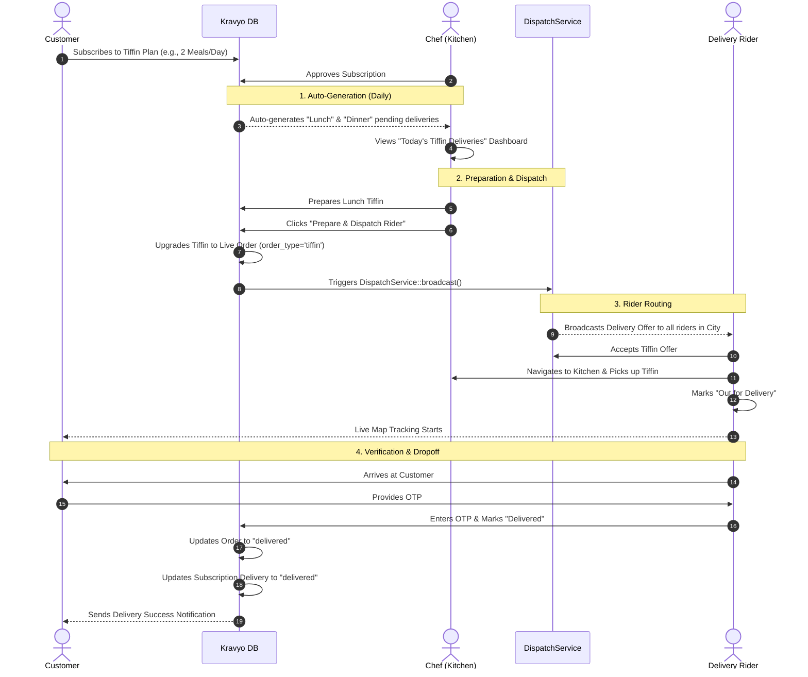

# Kravyo Tiffin Subscription Delivery Flow

This document outlines the end-to-end "Ultra Processing" lifecycle of a Tiffin Subscription meal in the Kravyo ecosystem, showing how the automated generation connects with the live Dispatch system.

## Complete Process Flow

## Key Upgrades Implemented

### 1. Meal-Specific Auto-Generation
Instead of generating one generic delivery record per day, the system now automatically scans the `meals_per_day` of each subscription.
- **1 Meal/Day**: Auto-generates a `lunch` delivery.
- **2 Meals/Day**: Auto-generates `lunch` and `dinner` deliveries.
- **3 Meals/Day**: Auto-generates `breakfast`, `lunch`, and `dinner` deliveries.
The Chef's dashboard explicitly tells them which meal type they need to prepare.

### 2. Seamless Order Upgrading
When the Chef clicks **"Prepare & Dispatch Rider"** on a Tiffin delivery, Kravyo seamlessly generates a virtual live order in the `orders` table. 
- It sets `order_type = 'tiffin'`.
- It sets `total_amount = 0` (since it's prepaid via subscription).
- It dynamically generates the instructions (e.g., `TIFFIN LUNCH - No Spice`).

### 3. Integrated Live Dispatch
Once the virtual order is created, the Tiffin completely enters the standard Kravyo delivery ecosystem.
- The `DispatchService` blasts the offer to nearby riders.
- The Rider accepts, navigates to the kitchen, and picks it up.
- The Customer gets full Google Maps live tracking.
- The Rider requires an OTP from the customer to complete the dropoff.

### 4. Dual-Synchronization
When the Delivery Rider drops off the Tiffin and submits the OTP, Kravyo automatically syncs backwards and marks the original `subscription_deliveries` record as `Delivered` to keep the Chef's subscription reports accurate.
